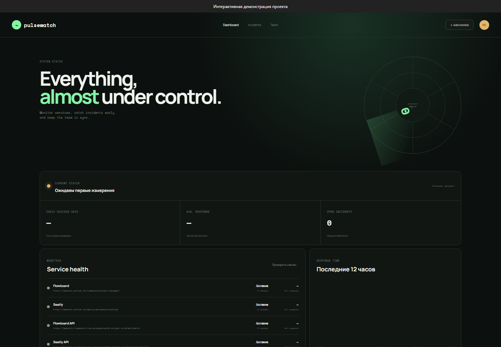
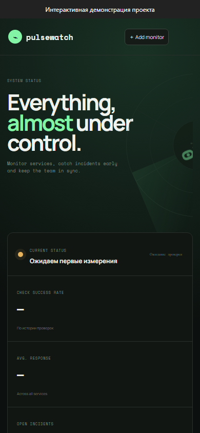
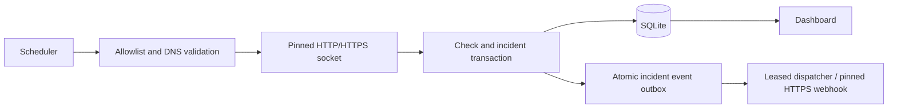

# Pulsewatch — Service Monitor

Periodically check owned HTTP services and retain measured availability, latency and incident history.






Screenshots were captured from the running local application with its bundled fixture data.

[Earlier sandbox interaction recording](docs/demo.gif)

## Implemented

- Automatic HTTP/HTTPS checks and a rate-limited manual cycle.
- Persisted check history, current status, response time and observed success ratio.
- One incident after two consecutive failures; automatic resolution after recovery.
- Optional durable webhook delivery for incident open/close events, with bounded retries.

## Stack and architecture

JavaScript, Express, Zod, built-in Node SQLite and a static HTML/CSS interface.



## Technical mechanisms and security

- `network-policy.js` validates the operator-owned hostname allowlist and every redirect. DNS results must be public addresses; the selected address is pinned into the actual socket lookup. HTTPS redirects cannot downgrade to HTTP.
- `transport.js` shares DNS pinning between probes and webhook delivery. It retains no response body and limits response headers to 16 KiB. Probe chains have a 20-second deadline; individual DNS/HTTP stages also have limits. DNS and HTTP work have bounded deadlines and an AbortSignal. The runner permits one active cycle and one outbound probe at a time; shutdown aborts and drains that cycle before closing SQLite.
- Intervals are constrained to 5 seconds–24 hours; retention to 1–365 days. Up to 30 targets are supported. The interval is a delay after a completed cycle, so slow targets extend the effective period.
- A check, current monitor state, incident transition and outbox event use one transaction. A failed write cannot publish a partial status. A target paused while its request is in flight cannot publish that late result. Manual values do not become measured history.
- `notifications.js` claims events with SQLite leases and fencing tokens, sends at most one request at a time, and stops after five attempts. Open/close event keys are stable; delivery is at-least-once, so receivers should deduplicate `Idempotency-Key`. Webhooks require HTTPS, never follow redirects, and reuse DNS/public-address checks. Logs contain fixed error categories, never the URL, credential or arbitrary remote body.

## Local setup

Node.js 24.18.0 and pnpm 11.7.0 (see version files).

```bash
npm install --global pnpm@11.7.0
pnpm install --frozen-lockfile
pnpm start
```

Open `http://localhost:4400`. For live UI development use `pnpm dev` where available. The API binds to `127.0.0.1` by default.

## Configuration

Configure process environment variables using [.env.example](.env.example). `pnpm start` uses the process environment; it does not implicitly load that file. To load a copied `.env` explicitly, run `node --env-file=.env server.js`.

## Database and upgrades

SQLite is stored at `data/pulsewatch.db`. Initialization creates/migrates the schema; sample rows are included for local use. Back up the database before upgrades. Do not remove the database as a migration step.

## Verification

```bash
pnpm lint
pnpm format:check
pnpm test
pnpm test:contract
pnpm test:upgrade
pnpm exec playwright install chromium
pnpm test:e2e
pnpm audit --audit-level=high
```

`tests/monitoring.test.js` and `tests/audit.test.js` use controlled resolver/request fixtures. They check DNS pinning, equivalent IPv6 notation, redirect policy, incident recovery, rollback, interval overflow, overlapping cycles and cancellation. They do not require public services to be reachable.

`tests/notifications.test.js` verifies atomic open/close events, restart recovery, five-attempt limits, shutdown, secret-safe logs and actual JSON delivery to a local mock through a test-only transport adapter. CI runs locked installation, lint/format, unit/API, contract/upgrade, browser checks and advisory scanning.

## Limits and next steps

- This is an operator-owned local tool without user accounts, not an open URL-checking API. Bind/expose it only behind appropriate access control.
- Only exact configured hostnames and standard HTTP/HTTPS ports are accepted. Credentials, query strings and fragments are rejected; special-purpose IP ranges are conservatively denied.
- Latency is time to response headers, not a full browser load. Availability is the ratio of retained observations, not a time-weighted SLA. The UI calls it **check success rate**; the API field `uptime` remains for compatibility.
- The local API validates Host and write Origin. This is not user authentication. A public reverse proxy must add access control; configure one `APP_PUBLIC_ORIGIN` if needed.
- Notifications are disabled unless `MONITOR_WEBHOOK_URL` is set. Existing incident history is not backfilled; events created after this schema upgrade are retained even while delivery is disabled. Enabling later drains that backlog. There is no retry/secret editor in the browser; configuration belongs to the operator.
- Delivered/failed outbox records and incidents are retained; backups and long-term archival remain operator tasks. A crash after remote acceptance can cause a retry. Five exhausted attempts need operator review, not an infinite automatic loop.
- Sequential probing intentionally limits concurrency. If target count or frequency grows, introduce a bounded worker pool rather than unbounded parallel requests.

See [network and delivery guarantees](docs/NETWORK_AND_DELIVERY.md) for the trust boundary and failure semantics.

## Further documentation

[Audit findings and follow-up](docs/AUDIT_2026_10.md) · [Technical reference](docs/TECHNICAL.md) · [Change history](CHANGELOG.md)

[API request/response example](docs/API_EXAMPLE.md)

[Revision and deployment checks](docs/DEPLOYMENT_CHECKS.md) — read-only `pnpm smoke` verifies a running Node API and an optional expected source SHA.
