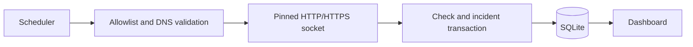

# Pulsewatch — Service Monitor

Periodically check owned HTTP services and retain measured availability, latency and incident history.


[Short interaction recording](docs/demo.gif)

## Implemented

- Automatic HTTP/HTTPS checks and a rate-limited manual cycle.
- Persisted check history, current status, response time and observed success ratio.
- One incident after two consecutive failures; automatic resolution after recovery.

## Stack and architecture

JavaScript, Express, Zod, built-in Node SQLite and a static HTML/CSS interface.



## Technical mechanisms and security

- `monitoring.js` validates the operator-owned hostname allowlist and every redirect. DNS results must be public addresses; the selected address is pinned into the actual socket lookup. HTTPS redirects cannot downgrade to HTTP.
- DNS and HTTP work have bounded deadlines and an AbortSignal. The runner permits one active cycle and one outbound probe at a time; shutdown aborts and drains that cycle before closing SQLite.
- Intervals are constrained to 5 seconds–24 hours; retention to 1–365 days. Up to 30 targets are supported. The interval is a delay after a completed cycle, so slow targets extend the effective period.
- A check, current monitor state and incident transition use one transaction. A failed database write cannot publish a partial status. Manual status values do not become measured history.

## Local setup

Node.js 24.18.0 and pnpm 11.7.0 (see version files).

```bash
npm install --global pnpm@11.7.0
pnpm install --frozen-lockfile
pnpm start
```

Open `http://localhost:4400`. For live UI development use `pnpm dev` where available. The API binds to `127.0.0.1` by default.

## Configuration

Configure process environment variables using [.env.example](.env.example). `pnpm start` uses the process environment; it does not implicitly load that file. To load a copied `.env` explicitly, run `node --env-file=.env server.js`.

## Database and upgrades

SQLite is stored at `data/pulsewatch.db`. Initialization creates/migrates the schema; sample rows are included for local use. Back up the database before upgrades. Do not remove the database as a migration step.

## Verification

```bash
pnpm test
pnpm test:contract
pnpm test:upgrade
pnpm exec playwright install chromium
pnpm test:e2e
pnpm audit --audit-level=high
```

`tests/monitoring.test.js` and `tests/audit.test.js` use controlled resolver/request fixtures. They check DNS pinning, equivalent IPv6 notation, redirect policy, incident recovery, rollback, interval overflow, overlapping cycles and cancellation. They do not require public services to be reachable.

CI installs locked dependencies and runs the configured checks; documentation checks also validate local links/images. Python dependency auditing uses `pip-audit --disable-pip --no-deps --strict -r requirements-lock.txt`. A passing scanner only reports known advisories at the time of the run.

## Limits and next steps

- This is an operator-owned local tool without user accounts, not an open URL-checking API. Bind/expose it only behind appropriate access control.
- Only exact configured hostnames and standard HTTP/HTTPS ports are accepted. Credentials, query strings and fragments are rejected; special-purpose IP ranges are conservatively denied.
- Latency is time to response headers, not a full browser load. Availability is the ratio of retained observations, not a time-weighted SLA. No external alert delivery is implemented.
- Sequential probing intentionally limits concurrency. If target count or frequency grows, introduce a bounded worker pool rather than unbounded parallel requests.

## Further documentation

[Audit findings and follow-up](docs/AUDIT_2026_10.md) · [Technical reference](docs/TECHNICAL.md) · [Change history](CHANGELOG.md)

[API request/response example](docs/API_EXAMPLE.md)
